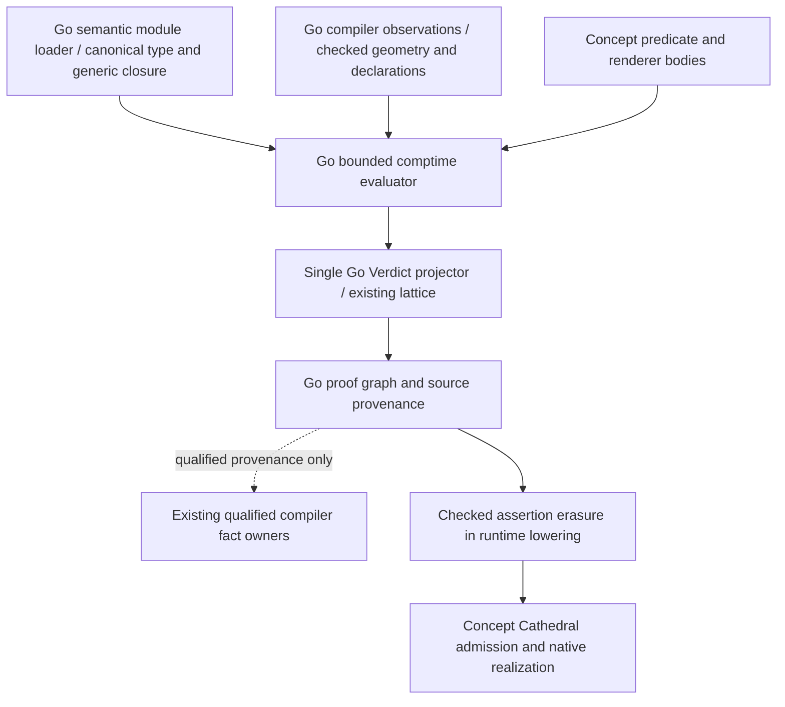

# EVT2h6 Verdict dependency and authority inventory

Inventory before implementation, 2026-10-31. Actual clean baseline is
`cb4201a9e277be8b0db3d16c9343ec6dd0926bc1` on
`codex/implement-native-ordinary-enums`. Fetched origin/main is `065317d`,
an ancestor six commits behind HEAD. Local main remains `7daab14`; no checkout
or unrelated work is replaced. Compiler: concept-evt1-stage0-go, Windows AMD64.
Baseline Quick passes in 23.96 s. The research ledger is actually at
`docs/conformance/R9B-RESEARCH-LEDGER.md`, not under docs/design.

## Existing contract and actual ownership

Verdict<E,R> is an intrinsic **comptime-only** semantic type. Proven(E),
Disproven(R) and payload-free Unknown project into the existing three outcomes.
Both closed payload types must be comptime-supported, including the unselected
alternative. Unknown never manufactures a refutation. Ordinary runtime return,
parameter and storage uses reject; neither Win64 classification nor runtime
tagged storage is required. The legacy fixed Holds/Refuted protocol and bool
predicates use the same compatibility projector.

| Subsystem / source | Current decision authority and Go dependency | Existing ordinary Concept implementation | Necessary input and execution / transport | Tests, prerequisites and migration difficulty |
| --- | --- | --- | --- | --- |
| Values: `types.go` Value, `typed_verdict.go` | Go evaluator constructs ValueEnum with full Type, variant and selected Payload; Go bounds/projector retain only selected E/R | Source constructs Proven/Disproven/Unknown; no Concept-owned evaluator value heap | Checked closed Type plus evaluated resource-free payload; compiler-time execution, no runtime ABI; Value metadata in proof/artifact JSON | Three-case values, arity/types, bounds and exhaustive match fixtures; replacing representation requires a shared evaluator-value contract: high |
| Closed applications: `validate.go`, `generic_identity.go`, `generic_types.go`, `comptime_templates.go` | Go resolves both ordered Verdict type arguments and checks payload eligibility; ordinary generic records/templates use canonical structured GenericApplication and existing substitution | Box/DataBox and other templates are authored in Concept | Intrinsic Verdict Type with canonical E/R; structured closed identity inside generic payloads; checked declarations and transported template bodies required, no physical layout equivalence | Distinct applications, missing/open bodies, artifact identity tests; migrating closure requires canonical type/declaration owner: high |
| Comptime execution: `comptime.go`, `comptime_subjects.go`, `comptime_templates.go` | Go AST interpreter owns dispatch, scope, calls, arithmetic, matching and fuel/depth/loops | Ordinary function/template bodies contain the algorithm being interpreted; that does not transfer evaluator ownership | Checked AST, typed Values, lexical and subject environments; compiler-time execution mandatory; bodies through semantic artifacts; runtime IO/allocation/machine effects excluded | R9b2 budget/recursion and comptime control-flow tests; no second evaluator justified: high |
| Predicate invocation: `predicate_requirements.go`, `innate_apply.go`, `project_policy.go` | Go binds semantic arguments, chooses lexical policy/innate environment, invokes evaluator and handles undecidability | `Standard.Semantic.Vocabulary`, embedded `innate/Innate.concept`, declared and manifest predicates | Checked concept requirement, predicate signature/body, closed type/declaration subjects and source site; comptime and artifact support, no native Verdict | Declared/innate/project-policy and artifact-only subject tests; needs evaluator plus observation contract: medium/high |
| Proof lattice/projection: `typed_verdict.go`, `semantic_facts.go` | Single Go `evt1ProjectPredicateVerdict` normalizes bool/legacy/typed values to SemanticFactCertainty; callers feed existing graph | Predicate bodies select cases; they do not own normalization or graph interpretation | Evaluated typed value, predicate identity and site; compiler-time projection, optional selected metadata; no runtime machine operation | Outcome and selected-payload comparisons, Unknown and compatibility tests; a second projector would duplicate authority: medium, coupled to evaluator |
| Proof graph: `proof_graph.go`, `concept_assert.go`, `generate.go` | Go builds nodes/edges, scopes subjects/sites/provenance and retains optional PredicateVerdict in MIRSemanticProof | No general Concept-owned proof graph implementation found | Existing requirement graph, selected metadata, semantic fact owners; compiler-time only; proof JSON/MIR metadata distinct from native MachineIR | Explain/diagnostic graph and source-site tests; requires stable semantic IDs, not physical object offsets: high |
| Semantic artifacts: `module_artifact.go`, `generic_identity.go`, `fact_transport.go` | Go hashes/loads concept-module.v2, verifies compiler/innate/dependency/generic identity, decodes compiler-private gob typed AST, and composes bodies/types; consumer re-evaluates | No Concept-owned concept-module.v2 AST/gob loader found; native bridge codecs consume a different contract | Inspectable JSON envelope plus encoded semantic AST, template bodies and closed declarations; optional sorted selected predicate_verdicts; source-free semantic consumption uses Go, not native Verdict | Artifact-only producer/consumer, corrupt/stale/missing body tests; a source-free Concept consumer needs a versioned typed-semantic contract and validator first: high |
| Diagnostics: `typed_verdict.go`, `proof_graph.go`, `lint.go` | Go validates renderer signatures, executes in the same evaluator state, enforces bounds and formats graph/site/severity | `JudgeDescribe`, `PlainDataHoldsDescribe`, `PlainDataHoldsUnknownDescribe`, innate `OwnershipProblem` and typed Describe own their authored wording | Selected R or original subjects for Unknown, same budget/environment/site; source/helper body transport; no runtime representation | Refutation/Unknown/invalid signature/empty/oversize tests; moving existing wording back to Go would regress ownership: low for bodies, high for execution driver |
| Trusted facts: `innate.go`, `concept_assert.go`, `semantic_facts.go`, `fact_transport.go` | Compiler-owned authority registry is empty; actual embedded authority plus innate declaration are required even to consult it. Existing fact owners separately verify layout/effects/alias/lifetime evidence | Ordinary predicates, including Proven, prove their own requirement only | Owner-checked evidence/provenance, never E/R spelling or serialized outcome. Predicate FactAuthority differs from imported operation-summary authority | Forgery tests for extent/allocation/alias/lifetime and empty registry; any positive projector requires explicit security/qualification work: high, deferred |
| Cathedral: `Standard.Backend.BridgeSchema3..9`, validators, AMD64 object/aggregate/scalar modules | Concept owns checked runtime artifact admission, physical layout realization, copy, ABI, allocation, frame and encoding; Go still supplies checked runtime semantics | Actual native validator/emitter algorithms are Concept-owned. Their use of Result and runtime enums does not make them a Verdict evaluator | Runtime MachineIR, not semantic AST/proof bodies. Existing bridge cannot stand in for a comptime evaluator or semantic module loader | Frozen bridges and native tests apply only if changed. Verdict runtime representation is unnecessary; executing residual checked runtime code is already supported |

### Evaluator bounds and value domain

Existing limits remain fuel **4096**, call depth **32**, per-loop bound **256**,
array length **64**, total selected payload nodes **512**, nesting **8**, and
string bytes **4096**. Closed bounded recursive templates share the caller's
state; they do not reset budgets. Resource-free records (including closed generic
records), payload enums, fixed bounded arrays, scalar/string values and opaque
type/declaration handles are supported. Pointer/reference/owned/Drop/immovable,
open parameters and runtime extents are not admitted as Verdict payloads.
Unsupported arithmetic/statements/effects remain diagnosed; this is not general
execution of arbitrary Concept. Declaration handles carry stable
owner/name/parent/index/provenance/site, not host addresses.

Typed evidence, typed refutation, outcome, graph metadata, provenance and a
trusted compiler fact are separate objects. Predicate bodies choose a semantic
case. The projector attaches the selected value to the existing outcome. The
proof graph records why/where. Only a qualified fact owner can authorize an
optimization. Hash integrity is not a signature or permission to hydrate trust.
Inspectable serialized predicate verdicts are not inputs to semanticFacts.

## Dependency graph and implementation decision



**Decision: no runtime Verdict; architectural closeout (A), with a bounded
residual-program admission correction.** The R9 machinery already implements
the intended three-case comptime protocol. Migrating its evaluator, generic
closure or AST artifact reader would be a larger prerequisite project, not h6.
No Concept authority movement is claimed for a body still interpreted by Go.

The actual native boundary is narrower and reproducible:

```powershell
go run ./cmd/concept lir language/evt1/semantic-vocabulary/valid/typed_predicate_protocol.concept
# Use: EVT2_UNSUPPORTED_CALL Concept at 31:5
```

The source is accepted; Go checks its Verdict-backed Assert.Concept, while C
`generate.go` already erases the marked assertion. LIR currently treats that
same statement as an ordinary runtime call. The smallest useful correction is
to erase the **semantically checked intrinsic statement** after normal semantic
analysis. Disproven/Unknown remain compile errors before runtime lowering.
No user spelling, numeric tag, serialized proof or renderer text supplies a new
permission. No evaluator, projector, trust registry or runtime ABI change is
planned. Native code will execute only the residual ordinary function.

## Verification plan and later prerequisites

Reuse the actual R9 protocol/value/negative fixtures. Compare source and
artifact-only re-evaluation for outcome, canonical types, selected payload,
predicate/site/provenance and diagnostics. Mutate/re-hash inspectable verdict
metadata to demonstrate that it cannot override the transported predicate body
or mint fact authority. Keep malformed/stale artifact rejection separate from
an accepted descriptive envelope that is deliberately ignored for decisions.

Demonstrate assertion erasure in LIR/MachineIR and compare residual C behavior
and native code to the same function without the compile-time assertion. Use
the existing CLI batch for actual Cathedral execution/emission, preserving
one backend build, and focused external native/C11 execution when applicable.
Use ten fresh h6 semantic/artifact/proof/runtime generations. Selected historical
R9 100-run tests retain their own counts. Run Quick, focused R9/proof/comptime/
artifact and trust regressions, race/vet, formatting/lint/diff. No full project
qualification is justified by erasing a checked zero-runtime-effect statement.

Future self-hosting prerequisites, in order (proposal only):

1. Specify a canonical checked semantic value/type/declaration/AST input boundary,
   including generic bodies, budgets, sites and observation requests. Current
   private gob is a concrete source-free migration dependency.
2. Qualify a bounded ordinary Concept consumer against Stage-0 while retaining
   one production evaluator and rollback path; do not add a parallel language.
3. Migrate execution and then the existing projection/proof consumer only when
   the required observation and canonical identity owners are available.
4. Migrate trusted fact production separately, with registered rule authority,
   independent provenance validation and escalated tests. Typed Proven alone
   must remain insufficient.

This milestone does not implement these later stages or start EVT2h7.
